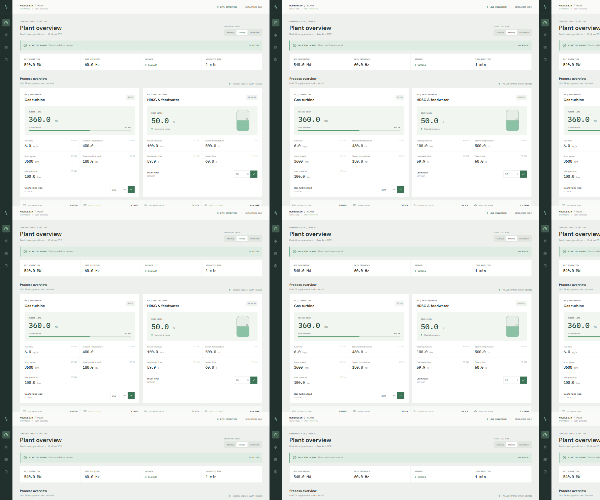
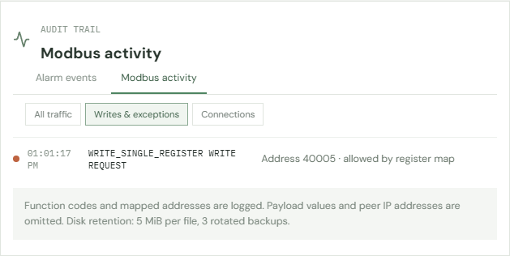
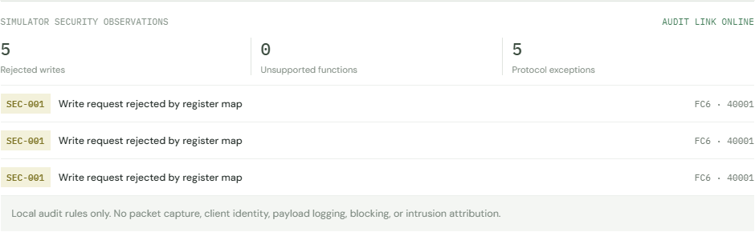

# Portfolio evidence

## Screenshots

The public [ModbusSim Plant demo](https://modbussim-plant-production.up.railway.app/) and [AlarmaWatch console](https://modbussim-plant-production.up.railway.app/alarmwatch/) run in read-only mode. The Modbus TCP listener is not publicly exposed.

The audit example is a same-value FC06 request against the local simulator. It records function, mapped address, and register-map policy outcome; payload values and peer IP addresses are intentionally omitted.

## Reproducibility

- Fresh Python 3.13 virtual environment created from `requirements.txt`; all **25 tests passed**.
- `npm ci` and `npm run build` passed independently for `frontend` and `alarmwatch/frontend`; both clean installs reported zero npm audit findings.
- `python scripts/demo_walkthrough.py` completed with `PASS`: `ALM-005` raised, acknowledged, setpoint restored, and returned to normal.
- A same-value FC06 write attempt to read-only register 40001 returned exception 02 and appeared as SEC-001. AlarmaWatch counted protocol exceptions separately.
- Final live check: ModbusSim setpoint 360 MW, AlarmaWatch connected in read-only mode, no active alarms.

The fresh Python test run emitted a Starlette deprecation warning about its `httpx`-based `TestClient` adapter; the reserved-function test also emits pymodbus's expected unknown-function diagnostic. All tests passed. No hardware-in-the-loop, live ICS, authentication, packet capture, or safety/security certification was performed.

See the [walkthrough runbook](portfolio_demo.md), [register map](register_map.md), and [AlarmaWatch scope](alarmwatch.md) for operating details and limitations.